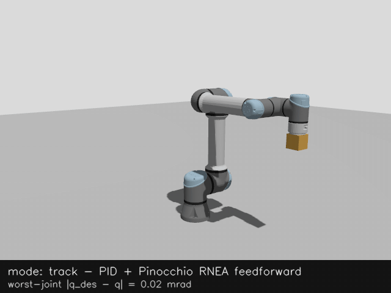
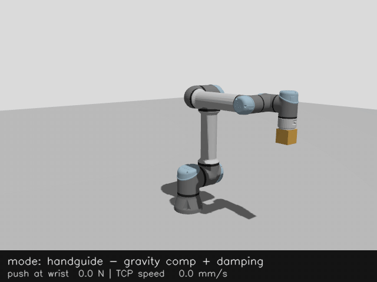
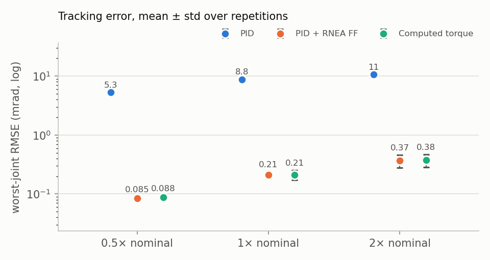
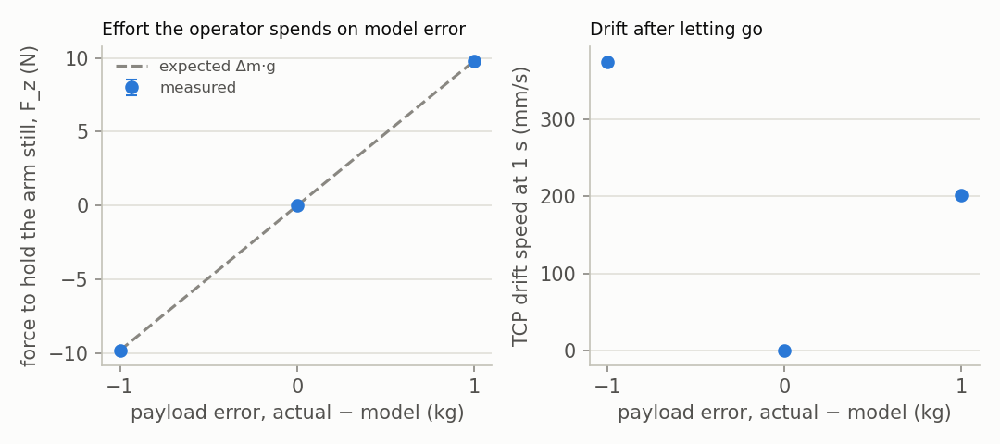

# ur5e-teaching-controllers

[](https://github.com/giridhar-shenoy/ur5e-teaching-controllers/actions/workflows/ci.yml)



This is a set of ros2_control effort controllers for a simulated UR5e (ROS 2 Lyrical, Gazebo Jetty): joint-space tracking with PID, PID + RNEA feedforward or computed torque on Pinocchio or KDL dynamics, gravity-compensated hand guiding with a runtime payload model, and damped-least-squares TCP jogging. These are controllers I shipped on production 6-axis arms, rebuilt in public on a UR5e, with every dynamics term computed from the URDF instead of hand-tuned. <!-- headline:begin -->
At 1× nominal speed the RNEA feedforward brings the worst-joint tracking RMSE to 0.21 ± 0.03 mrad (PID alone: 8.81 ± 0.01 mrad, computed torque 0.21 ± 0.04 mrad), and in hand guiding a 1 kg payload-model error costs the operator 9.81 ± 0.00 N of vertical force to hold the arm still (Δm·g = 9.81 N) and, let go, carries the TCP 201 ± 4 mm in one second.
<!-- headline:end -->

**Language split:** C++17 for everything in the 500 Hz control loop (controllers, the Pinocchio
and KDL dynamics backends, trajectory profiles) and for the timing benchmark that measures it;
Python only for orchestration, recording and plots — the loop must not depend on a garbage
collector, and nothing outside it needs C++.

## Run it

```bash
# in the devcontainer (.devcontainer/, ROS 2 Lyrical image) or on Ubuntu 26.04 + ROS 2 Lyrical:
scripts/build.sh && source install/setup.bash
ros2 launch ur5e_teaching_bringup sim.launch.py mode:=track      # headless; or mode:=handguide
```

Then, in another shell:

```bash
# track: send any joint trajectory to the effort tracking controller
ros2 topic pub --once /pid_ff_trajectory_controller/joint_trajectory trajectory_msgs/msg/JointTrajectory \
  "{joint_names: [shoulder_pan_joint, shoulder_lift_joint, elbow_joint, wrist_1_joint, wrist_2_joint, wrist_3_joint],
    points: [{positions: [0.5, -1.2, 1.2, -1.2, -1.2, 0.5], time_from_start: {sec: 3}}]}"
# handguide: switch modes, then push the wrist for one second
ros2 launch ur5e_teaching_bringup mode.launch.py mode:=handguide
ros2 topic pub --once /world/bench/wrench/persistent ros_gz_interfaces/msg/EntityWrench \
  "{entity: {name: 'ur::wrist_3_link', type: 3}, wrench: {force: {y: 8.0}}}"
ros2 topic pub --once /world/bench/wrench/clear ros_gz_interfaces/msg/Entity "{name: 'ur::wrist_3_link', type: 3}"
```

Everything is headless by default (`gazebo_gui:=true` for the Gazebo client); add
`dynamics_backend:=kdl` to run both controllers on orocos KDL instead of Pinocchio. Benchmarks,
figures and GIFs: `scripts/regenerate_all.sh`.

| Mode | Controller | Claims | What it shows |
|---|---|---|---|
| `track` | `PidFfTrajectoryController` | `*/effort` | Trapezoidal re-profiled trajectories with one of three laws: PID with anti-windup, PID + RNEA feedforward, or computed torque (`control_law`) |
| `handguide` | `GravityCompHandGuidingController` | `*/effort` | g(q) + C(q,q̇)q̇ − Dq̇, runtime payload, joint-limit repulsion, speed cap |
| `jog` | `TcpJogController` | `*/effort` | TCP twist → damped least squares with manipulability-scheduled damping, speed/acceleration/position limits, deadman |

 

## Results

Simulation only; every cell comes from `results/*.csv` through `scripts/make_results.py`, and a
test fails if this table and [docs/results.md](docs/results.md) disagree. Method, per-joint
numbers and the commit/seed of each run are in [docs/results.md](docs/results.md). The tracking
and hand-guiding numbers were produced with the Pinocchio backend (the default).

<!-- results:begin -->
**Joint-space tracking** (PidFfTrajectoryController, 3-segment 6-joint path; worst joint per repetition, then mean ± std over repetitions):

| Speed (× nominal) | PID: worst-joint RMSE (mrad) | PID + RNEA FF: worst-joint RMSE (mrad) | Computed torque: worst-joint RMSE (mrad) | PID: worst max \|e\| (mrad) | PID + RNEA FF: worst max \|e\| (mrad) | Computed torque: worst max \|e\| (mrad) | Regenerate with |
|---|---|---|---|---|---|---|---|
| 0.5 | 5.34 ± 0.00 | 0.08 ± 0.00 | 0.09 ± 0.01 | 12.03 ± 0.14 | 0.50 ± 0.00 | 0.60 ± 0.23 | `scripts/bench_tracking.sh` |
| 1 | 8.81 ± 0.01 | 0.21 ± 0.03 | 0.21 ± 0.04 | 20.67 ± 0.04 | 0.94 ± 0.07 | 0.84 ± 0.07 | `scripts/bench_tracking.sh` |
| 2 | 10.68 ± 0.04 | 0.37 ± 0.09 | 0.38 ± 0.09 | 26.45 ± 0.36 | 2.83 ± 1.00 | 2.52 ± 1.47 | `scripts/bench_tracking.sh` |

**Hand guiding with a wrong payload model** (GravityCompHandGuidingController, model payload fixed, actual Gazebo payload varied; mean ± std over repetitions):

| Model / actual payload (kg) | Payload error (kg) | TCP drift speed at 1 s (mm/s) | TCP drift in 1 s (mm) | Effort to hold, F_z (N) | Expected (Δm·g, N) | Regenerate with |
|---|---|---|---|---|---|---|
| 1 / 0 | -1 | 374.42 ± 1.98 | 296.18 ± 4.44 | -9.81 ± 0.00 | -9.81 | `scripts/bench_handguide.sh` |
| 1 / 1 | +0 | 0.00 ± 0.00 | 0.00 ± 0.00 | 0.00 ± 0.00 | 0.00 | `scripts/bench_handguide.sh` |
| 1 / 2 | +1 | 201.97 ± 2.39 | 201.04 ± 3.53 | 9.81 ± 0.00 | 9.81 | `scripts/bench_handguide.sh` |

**Cost of one dynamics call** (gravity g(q) and RNEA on each backend, single thread; median / p95 over 100 000 timed calls):

| Per call, median / p95 (µs) | Pinocchio g(q) | Pinocchio RNEA | KDL g(q) | KDL RNEA | Worst p95, share of the 2 ms cycle | Regenerate with |
|---|---|---|---|---|---|---|
| UR5e, 6 DoF, one thread | 0.538 / 0.740 | 0.887 / 1.123 | 1.678 / 1.748 | 1.702 / 2.155 | 0.1077 % | `scripts/bench_dynamics_timing.sh` |
<!-- results:end -->

<picture>
  <source media="(prefers-color-scheme: dark)" srcset="docs/assets/tracking_rmse_dark.png">
  
</picture>
<picture>
  <source media="(prefers-color-scheme: dark)" srcset="docs/assets/handguide_dark.png">
  
</picture>

## Two dynamics backends

Both controllers get their dynamics through one interface with two implementations, chosen per
controller by the `dynamics_backend` parameter: `pinocchio` (the default) or `kdl`. On the
production 6-axis arms I used KDL's recursive Newton–Euler solver (`ChainIdSolver_RNE`), with
`ChainDynParam` for gravity, mass matrix and Coriolis terms; here Pinocchio is the default,
because the same model also gives frame Jacobians, placements and analytical derivatives, and it
is the faster of the two. Both are built from the same URDF, and gravity comes from one
`gravity_z` parameter shared by both, which has to match the world (SDF's default is 9.8, not
9.81). `test_dynamics_equivalence` runs both on 200 random states inside the joint limits, with
and without a 1 kg payload, and requires gravity and RNEA torques to agree within 1e-6 N·m per
joint, mass matrices within 1e-6 and Jacobians within 1e-9; they agree to rounding error (the
test prints its worst deviations). The timing row above shows what the choice costs:
Pinocchio is faster on both calls, and neither uses more than a fraction of a percent of the
2 ms cycle. A runtime payload change rebuilds the model outside the realtime loop (for KDL
that means new solvers) and `update()` only swaps a pointer.

## Where it fails

1. **A wrong payload model makes the arm drift, and the operator pays for it.** The hand-guiding
   table above shows the arm rising or sinking when the model payload is off, and the vertical
   force needed to hold it tracks Δm·g. Damping slows the drift; it does not remove it.
2. **Switching a joint from effort back to position drops the arm (gz_ros2_control 3.0.9).**
   After an effort controller has run, activating the stock position
   `joint_trajectory_controller` leaves the joints with zero torque and the arm falls onto the
   ground. I did not find the root cause in the binary package; the workaround is that there is
   no way back to position control: homing uses the effort tracking controller.
3. **The stock `ur_sim_control.launch.py` does not work on Lyrical as shipped.** Its spawners
   pass no parameter file (ros2_control 6.10.1 then starts the trajectory controller with no
   joints), and when Gazebo boots slowly its `create` node spawns a second robot on top of the
   first. `sim.launch.py` fixes both; see its docstring.
4. **The speed cap is a hard stop, and its fallback is a position hold.** If any joint exceeds
   `max_joint_velocity`, hand guiding returns an error; the controller_manager then activates
   the configured fallback (the tracking controller), which holds the arm where the trip
   happened. Without a fallback nothing would actively hold the arm. With
   the shipped damping a sustained push of a few tens of newtons does not trip the default cap;
   I verified the fallback path by lowering the cap at runtime.
5. **Without feedforward, PID sags first and tracks late.** The integrator has to build up the
   gravity torque before it can hold the arm, and during motion the inertial and Coriolis torques
   show up as tracking error; compare the PID-only and PID + RNEA columns above.
6. **Computed torque buys nothing over PID + feedforward here, and is more fragile.** With exact
   models and the same nominal bandwidth the two track about equally well on a quiet machine
   (table above). Under CPU contention computed torque fell further behind (a check made while
   other sessions compiled, NOTES.md). It feeds the measured state back through the whole
   inverse dynamics, so lag in that state reaches the torque directly. On a real arm, where the
   model is wrong, that trade would need measuring again.
7. **The wrist_3 loop is at the edge of what a 2 ms explicit loop allows.** Its joint-space
   inertia is tiny (the last link plus whatever is bolted to the flange), so K_d·Δt/M must stay
   below one; its gains are tiny too, and a payload changes its dynamics more than any other
   joint's.
8. **Gazebo's effort interface is kinder than a real arm's.** No joint friction, no gearbox
   compliance, no motor current limits or torque ripple, perfect torque tracking, and an exactly
   known model: the feedforward numbers here are an upper bound on what a real UR5e would give.
9. **The feedforward tracking numbers depend on what else the machine is doing.** Run next to
   another session's benchmark on the same laptop, the RNEA-feedforward rows came out clearly
   worse than when run alone, while the PID-only and hand-guiding rows did not move (the run
   log, with the numbers, is in NOTES.md). It is not only other benchmarks: the v0.1 table
   showed PID + feedforward several times lower than the one above, and re-running the v0.1
   code itself on 29 Oct reproduced the new level, not its own, with no package changed in
   between. I have not pinned down the cause; gz_ros2_control runs the controller manager
   inside the physics step, so the suspect is the ROS side (when commands are adopted, what is
   recorded) rather than the control law. `scripts/regenerate_all.sh` refuses to start while a
   simulator, build, pip install or training run is active, and the published rows were made
   alone; treat the feedforward rows as a level, not a precise number.
10. **Trajectories stop at every waypoint, and pre-emption is abrupt.** The trapezoidal
   re-profiling is rest-to-rest per segment (no blending), which is simple and exactly testable
   but slower than necessary. A new trajectory pre-empts the running one from the current
   desired position at zero velocity, so pre-empting at cruise speed steps the desired velocity
   to zero and the K_d term produces a torque spike.

## What transfers to a real UR and what does not

The real UR5e is commanded through `ur_robot_driver` over RTDE with position or velocity
targets; the joint-torque interface these controllers claim is a simulation affordance, not
something the stock driver gives you. On that interface **hand guiding becomes velocity
servoing on a force estimate**: read the wrist F/T sensor (exposed here too, as
`tcp_fts_sensor`), subtract the payload's gravity wrench using the same Pinocchio payload model,
and command a TCP velocity proportional to the remaining external force through the Jacobian
(an admittance law), with the same speed cap and limit handling. The tracking controller's
feedforward would move into the trajectory generator (torque-feasibility checks, time scaling)
instead of the torque loop. What transfers unchanged is the structure: dynamics from the URDF
through Pinocchio or KDL, runtime payload, safety layers, and the benchmarks that tell you what a
model error costs.

## What I'd do next

1. Publish `bench_jog`'s command-to-motion latency for the `TcpJogController`, and add a
   singularity-approach benchmark (damped vs undamped joint speeds).
2. Add the admittance controller on the wrist F/T sensor, i.e. the hand-guiding law that would
   actually run on a real UR over RTDE.
3. MPC for tracking: it needs a QP solved inside the 2 ms loop (a real-time-safe solver,
   warm-starting, a fallback when it misses the deadline), which is a separate piece of work
   from the controllers here.
4. A system-identification notebook as a simulation experiment: excite the simulated arm, fit
   the inertial parameters, and measure how far the fitted model's feedforward is from the
   URDF's.

Also not done yet: IBVS servoing demo, quintic profiles, a FollowJointTrajectory action server,
the full 5-speed × 4-variant × 5-repetition tracking grid, and a `ur5e_teaching_msgs` package.

## More

- [docs/controllers.md](docs/controllers.md) — the math of both controllers and both dynamics backends
- [docs/what_broke.md](docs/what_broke.md) — draft
- [docs/architecture.md](docs/architecture.md) — nodes, controllers, interfaces, data flow
- [docs/results.md](docs/results.md) — every number, with the command that produces it

MIT licensed. Third-party material is listed in [THIRD_PARTY.md](THIRD_PARTY.md).
