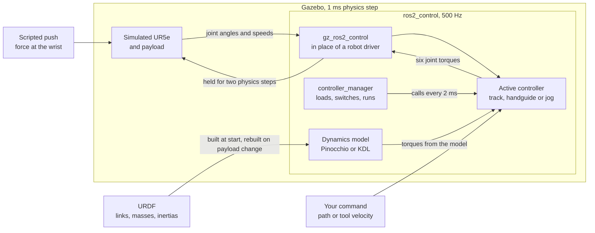

# ur5e-teaching-controllers

[](https://github.com/giridhar-shenoy/ur5e-teaching-controllers/actions/workflows/ci.yml)

Three controllers for teaching a simulated UR5e industrial robot arm by hand: it holds its own
weight while you push it, follows a given trajectory (a path with timing) closely, and moves its
tool in straight lines, computing most of each joint's torque from a physics model of the arm
instead of only reacting to errors.


*Hand guiding in Gazebo, a robot physics simulator. Both arms carry the same 1 kg load, and in both
the hand-guiding controller adds the same viscous damping (a torque opposing each joint's speed).
The tracking controller (the path-following one, described below) holds both still, then hand
guiding takes over and a scripted 10 N push at the wrist runs for 1.5 s. Left, correct payload model
(the controller's estimate of the load): the arm glides, then stops. Right, load left out of the
model: the arm sinks the whole time.*

## What this is

Teach-by-demonstration programs an industrial arm by example: an operator moves it through a task,
and the robot records the poses (tool positions and orientations) and replays them. That needs three
controllers: one that holds the arm's weight while it is pushed, one that follows a trajectory
accurately, and one that moves the tool along straight lines on command. This repository provides
those three; recording and replaying a demonstration end to end is not part of it.

A real UR5e can already be guided by hand and moved on command. This is an open, from-scratch build
of all three controllers for ROS 2 (a robot software framework) and ros2_control (its framework for
real-time controllers). It is for anyone who wants readable code, with its accuracy measured in
simulation, to study, or a starting point for another arm that runs ros2_control; real hardware
needs the changes under [What transfers](#what-transfers-to-a-real-ur-and-what-does-not).

- **Hand guiding** cancels, at every joint, the weight of the arm and of the payload the model
  assumes, so the arm floats and a push moves it.
- **Tracking** follows a trajectory (joint positions over time) with one of three control laws
  (rules that turn the error into torque): PID feedback (the position error, its integral and its
  rate of change, each scaled by a fixed gain); PID plus feedforward, which adds the torque the
  arm's model predicts the planned motion needs; or computed torque, which treats the PID output as
  a desired acceleration and uses the model, at the arm's actual joint angles, to work out the
  torque that produces it.
- **Jogging** turns a tool velocity sent as a command (from the command line or a script) into joint
  speeds, so the tool follows a straight line; near a singularity (a pose, such as the arm fully
  stretched, where moving the tool in some direction would need infinitely fast joints) it gives up
  some path accuracy to keep joint speeds bounded.

What it proves, in simulation: the controllers compute and apply the model's torques correctly. The
controllers' model and the simulated arm are built from the same URDF (the robot's description file:
its links, or rigid segments, with their masses and inertias), so a correct controller should remove
nearly all of the tracking error and leave exactly the payload error for the operator to hold, and
that is what the numbers show. It is a self-consistency check, not a test of a wrong or incomplete
model; the simulator has no friction, and no motor limits or delays. Two independent libraries that
compute torques from the arm's model, Pinocchio and KDL, agree to rounding error in an automated
test. <!-- headline:begin -->
With the shipped PID gains, PID plus feedforward made the worst joint's root-mean-square tracking error between about 60 and 110 times smaller than PID alone. Most of the error that remains is a timing artefact: the simulation compares the commanded angle (the reference) with the measured angle a fraction of a millisecond apart, by a time gap that changes from run to run, so a moving joint shows an error proportional to its speed even when it is on the path. That is why the factor is a range, and the true improvement is probably larger. Computed torque did the same; the artefact hides any difference between the two. By construction (it follows from how the controller is built, not from a measurement), a payload model off by some mass leaves exactly that weight for the operator to hold.
<!-- headline:end -->

The gains are listed in [docs/controllers.md](docs/controllers.md#gains-and-bandwidths); the
measured errors themselves are under [Results in one breath](#results-in-one-breath).

**Language split:** C++ (2017 standard) for everything that runs every 2 ms in the control loop;
Python for launching and recording the simulation and for plots.

**To run it:** Ubuntu 26.04 with ROS 2 (Lyrical release), or the included Docker setup (a packaged
copy of the whole software environment); build with `scripts/build.sh`, then
`ros2 launch ur5e_teaching_bringup sim.launch.py mode:=track` (or `handguide`, `jog`); see
[Run it](#run-it), which also shows how to send the arm commands from a second terminal. CI
(continuous integration) builds and tests every change; it does not rerun the benchmarks (the
scripted measurements behind the numbers).

## See it


*Same path, same gains; feedforward removes most of the error. Left: PID alone. Right: PID plus
feedforward. The large number on each panel is the worst joint's error at that instant, in mrad
(milliradians), above a running plot of it on a shared scale.*


*Two parts. First, a jog straight up at 50 mm/s: the tool's trace follows the dashed commanded line.
Then a jog sideways towards the wrist singularity, where two wrist axes line up: the controller
raises its damping (a term in its tool-to-joint-speed calculation, unrelated to the viscous damping
in hand guiding, that accepts some error in the tool's path to keep the joints slow), so the tool
slows down and drifts off the line. The strip below shows the tool speed, its distance from the line
and the fastest joint speed.*

## Run it

Get the code with `git clone https://github.com/giridhar-shenoy/ur5e-teaching-controllers.git` and
`cd ur5e-teaching-controllers`. Either work on Ubuntu 26.04 with ROS 2 Lyrical installed, or use the
devcontainer: open the folder in VS Code with the Dev Containers extension and choose "Reopen in
Container", which builds the Docker setup from the repository's `Dockerfile` and opens a terminal
inside it. In a first terminal, build once and start the simulation:

```bash
# in the devcontainer (.devcontainer/, ROS 2 Lyrical image) or on Ubuntu 26.04 + ROS 2 Lyrical:
scripts/build.sh && source install/setup.bash
ros2 launch ur5e_teaching_bringup sim.launch.py mode:=track      # headless (no window); or handguide / jog
```

`source install/setup.bash` makes the freshly built code visible to the `ros2` command, and
`ros2 launch` starts the simulator, the arm and the controllers; `name:=value` sets an option. The
simulation keeps running in this terminal until you press Ctrl-C. It has no window unless you add
`gazebo_gui:=true`.

Everything below goes in a second terminal; run `source install/setup.bash` there first.
`ros2 topic pub` publishes a message on a topic, a named channel a controller listens on: the quoted
text is the message, and the word before it names the message format.

**Track.** Send a one-point path, a target pose to reach three seconds from now:

```bash
ros2 topic pub --once /pid_ff_trajectory_controller/joint_trajectory trajectory_msgs/msg/JointTrajectory \
  "{joint_names: [shoulder_pan_joint, shoulder_lift_joint, elbow_joint, wrist_1_joint, wrist_2_joint, wrist_3_joint],
    points: [{positions: [0.5, -1.2, 1.2, -1.2, -1.2, 0.5], time_from_start: {sec: 3}}]}"
```

The positions are joint angles in radians, in the order of `joint_names`. The arm starts elbow up
with the tool pointing down; in the target pose the base and the last wrist joint are turned by half
a radian (about 30°) and the four joints in between have moved by about 0.4 rad. All six joints
start together, speed up, cruise and slow down, and the arm stops at the target about three seconds
later. The default law is PID plus feedforward. To compare the laws, in the second terminal:

1. Send the arm back to the start pose: repeat the command above with
   `positions: [0.0, -1.57, 1.57, -1.57, -1.57, 0.0]`.
2. Change the law while the simulation runs. For PID alone:
   `ros2 param set /pid_ff_trajectory_controller feedforward false`; for computed torque:
   `ros2 param set /pid_ff_trajectory_controller control_law computed_torque`.
3. Send the original target again.
4. Watch the result: `ros2 topic echo /pid_ff_trajectory_controller/controller_state` prints the
   reference and the measured state as the arm moves; the tracking GIF above shows the difference.

**Hand guiding.** Switch the running simulation to hand guiding, then push the wrist sideways with
10 N, the same push as in the GIF, and remove the push a second or two later:

```bash
ros2 launch ur5e_teaching_bringup mode.launch.py mode:=handguide
ros2 topic pub --once /world/bench/wrench/persistent ros_gz_interfaces/msg/EntityWrench \
  "{entity: {name: 'ur::wrist_3_link', type: 3}, wrench: {force: {y: 10.0}}}"
ros2 topic pub --once /world/bench/wrench/clear ros_gz_interfaces/msg/Entity "{name: 'ur::wrist_3_link', type: 3}"
```

The first command switches controllers and exits. The second asks Gazebo to keep applying a force
(the message calls it a wrench: a force and a torque together) to the last wrist link (`type: 3`
means a link) until the third removes it. The arm holds its pose on its own, glides sideways while
the force is on, and the viscous damping brings it to rest once the force is removed.

**Jog.** Switch to jogging, then stream a tool velocity of 5 cm/s straight up:

```bash
ros2 launch ur5e_teaching_bringup mode.launch.py mode:=jog
ros2 topic pub -r 50 /tcp_jog_controller/twist geometry_msgs/msg/TwistStamped \
  "{header: {frame_id: world}, twist: {linear: {z: 0.05}}}"
```

`-r 50` repeats the message 50 times a second. The velocity is given in the world frame
(`frame_id: world`), the fixed coordinate frame the arm's base is bolted to, so `z` is straight up.
The tool rises while the stream runs; stop it with Ctrl-C and, because the controller zeroes any
command older than 0.1 s, the arm stops and holds where it is.

Add `dynamics_backend:=kdl` to the launch line to compute the model with KDL instead of Pinocchio
(see [Two dynamics backends](#two-dynamics-backends)). `scripts/regenerate_all.sh` reruns every
benchmark (the scripted measurements behind the numbers under Results) and rebuilds the figures and
GIFs.

## How it works

Everything runs inside the Gazebo program, which advances the physics in 1 ms steps. Inside it runs
ros2_control at 500 Hz: its controller_manager loads the controllers and switches between them, and
gz_ros2_control connects it to the simulated joints, taking the place of the software that would
talk to a real robot's motors. Every 2 ms the active controller reads each joint's angle and speed,
computes six torques and writes them to the joints' effort interfaces (ros2_control's name for a
joint's torque input); Gazebo applies them for the next two physics steps. Each controller takes
exclusive hold of all six torque inputs, so exactly one runs at a time, and switching modes hands
the arm from one to the next.



### Tracking: `PidFfTrajectoryController`, mode `track`

It receives a path as waypoints (joint positions with arrival times) and re-times each stretch
between waypoints as a trapezoidal profile: speed up, cruise, slow down, stopping at each waypoint,
with all joints starting and stopping together inside their speed and acceleration limits. The
profile gives, at every instant, the reference (where each joint should be and how fast it should
move); every 2 ms the controller compares it with the measured state (where each joint is and how
fast it moves) and turns the difference into torque. Both model-based laws get their torques from
RNEA (the recursive Newton–Euler algorithm, the standard link-by-link calculation of the torques a
motion needs). Feedforward predicts the torque for where the arm should be and adds the PID
correction on top; computed torque computes it for where the arm is and also scales the correction
by the arm's inertia, so a gain gives the same response in every pose (with plain PID, the same gain
moves a light joint or pose faster than a heavy one). Torque is capped at each joint's limit, and a
new path replaces the running one at once, starting from the current reference at zero speed. The
benchmark runs one fixed path at its nominal speed (the timing it was planned with) and at half and
double that. Equations and gains: [docs/controllers.md](docs/controllers.md#tracking-controller).

### Hand guiding: `GravityCompHandGuidingController`, mode `handguide`

Every 2 ms it applies the model's gravity torque, plus the torques that arise when several joints
turn at once (Coriolis and centrifugal effects), minus viscous damping, so the arm comes to rest
when released. With a correct payload model the arm floats and a push moves it against the damping
alone; if the payload model is off by Δm kilograms, holding the arm still takes the weight of the
error, Δm·g (g being gravitational acceleration). The payload's mass and position can be changed
while it runs; the new model is built outside the 2 ms loop. Near a joint's travel limit a
spring-like torque pushes the joint back. If any joint moves faster than its speed cap, hand guiding
reports an error and ros2_control activates the tracking controller in its place (it is configured
as hand guiding's fallback and kept loaded for this), which holds the arm where it is by braking
hard. Details: [docs/controllers.md](docs/controllers.md#hand-guiding).

### TCP jogging: `TcpJogController`, mode `jog`

The command is a velocity of the TCP (tool centre point, the tip of the tool). Every 2 ms the
controller converts it into joint speeds through the Jacobian, the matrix that relates joint speeds
to tool velocity at the current pose, by damped least squares (it picks the joint speeds whose tool
velocity comes closest to the command): an exact solution would demand huge
joint speeds near a singularity, so the solver adds damping in the least-squares solution, a term
that accepts a small error in the tool's motion in exchange for bounded joint speeds. This damping
is zero far from a singularity and grows as manipulability, a measure of how far the arm is from
one, falls below a threshold. Speed, acceleration and joint-limit caps scale all joint speeds
together, so the tool keeps its direction and only slows. Because the joints accept torque, not
speed, the joint speeds are added up over time into a reference (the joint positions the arm should
reach next) that a PID-plus-feedforward loop, the same as the tracking controller's, drives the arm
to. If no command arrives for 0.1 s the command is set to zero and the arm holds where it stopped;
velocities in another frame or with invalid numbers are refused. The reference is built without
looking at the arm, so if the arm were blocked the reference would run ahead and the torque would
climb to the limit. Details: [docs/controllers.md](docs/controllers.md#tcp-jogging).

### Two dynamics backends

The model calculations come from one of two open-source libraries that compute torques from the
arm's model, the dynamics backends, chosen per controller by the `dynamics_backend` parameter:
Pinocchio (the default, and the faster) or KDL (the Orocos Kinematics and Dynamics Library, which
most older ROS arm software used). Keeping both lets each check the other: an automated test
evaluates them on random poses, with and without a payload, and requires their torques and Jacobians
to agree to rounding error. Both read the same URDF and one shared gravity setting, `gravity_z`,
which has to equal the simulator's. Details:
[docs/controllers.md](docs/controllers.md#two-dynamics-backends).

## Results in one breath

Every result in this README is regenerated by a script (`scripts/regenerate_all.sh`). Tracking error
is reported as the RMSE (root-mean-square error over the whole path) of the joint that tracks worst,
in mrad.

<!-- breath:begin -->
Tracking: on one path through all six joints, at the speed the path was designed for, PID alone leaves an RMSE of about 8.8 mrad on the worst joint. PID plus feedforward brings it to 0.08–0.14 mrad and computed torque to 0.07–0.13 mrad across five runs of the same code: about two orders of magnitude lower, with neither law ahead in every run. Hand guiding: with the payload model 1 kg wrong, holding the arm still takes 9.81 N, the weight of 1 kg (1 kg × 9.81 m/s²). That number is fixed in advance, by construction: the simulated arm and the controller use the same model and the same gravity, so the mass the model gets wrong is the only thing left unbalanced, and its weight is what the operator has to hold. What the benchmark can still catch is a mistake in the controller: had it attached the payload to the wrong part of the arm, or had the switch from one controller to the next jolted the arm, the force would miss 9.81 N, or would not be zero with the correct model; it hits both to within 0.0001 N. Computing the dynamics is cheap: one RNEA call takes 0.78 µs (microseconds; the median call on the default backend), against 2 ms between control updates. The caveat: the recorded reference and the measured joint angle are compared at slightly mismatched instants, a fraction of a millisecond apart, and that mismatch changes from run to run; it is what moves the feedforward and computed-torque numbers between runs. CPU load from other programs was the first suspect, but the load average (a measure of how busy the computer was) logged during each of the five runs does not line up with their errors ([run-to-run spread](docs/results.md#run-to-run-spread)).
<!-- breath:end -->

The GIF at the top (a 0 kg payload model on a real 1 kg load) has the same error as the hand-guiding
row below where the model assumes 1 kg and the real load is 2 kg: in both, the model is 1 kg too
light.

<!-- results:begin -->
| What was measured | Without the model, or with it wrong | With the model | What it means |
|---|---|---|---|
| **Tracking:** RMSE of the worst of the six joints, at the speed the path was designed for (mrad) | PID alone: about 8.8 | PID plus feedforward: 0.08–0.14<br>computed torque: 0.07–0.13<br>(lowest–highest of five runs) | About two orders of magnitude less error, with neither law ahead in every run |
| **Hand guiding:** force needed to hold the arm still | model 1 kg, real 0 kg: 9.81 N, pushing down<br>model 1 kg, real 2 kg: 9.81 N, holding up | model 1 kg, real 1 kg: 0.00 N | Equal to Δm·g (the mass error times gravity), by construction. The GIF at the top (model 0 kg, real 1 kg) has the same 1 kg error as the model 1 kg, real 2 kg row |
| **Hand guiding:** how far the tool moves in the first second after letting go | model 1 kg, real 0 kg: rises 296 mm<br>model 1 kg, real 2 kg: sinks 201 mm | model 1 kg, real 1 kg: 0.00 mm | The arm drifts until someone holds it; it moves less when the real payload is 2 kg than when it is 0 kg, because there is more mass to accelerate |
| **Dynamics cost:** time for one RNEA call, median, in µs (microseconds) | — | Pinocchio (the default): 0.78<br>KDL: 1.50 | Far inside the 2 ms control cycle: 95 % of RNEA calls on either backend finish within 1.7 µs, under a thousandth of the cycle |

<picture>
  <source media="(prefers-color-scheme: dark)" srcset="docs/assets/tracking_rmse_dark.png">
  
</picture>

Lower is better. 1× is the speed the path was designed for; 0.5× and 2× run the same path slower or faster. Each bar is the worst joint's RMSE: the median of the five runs, printed above the bar, with a whisker (a thin line from the lowest to the highest run). The left panel is PID alone; the right panel shows PID plus feedforward and computed torque on a scale 30 times finer, because at the left panel's scale they would barely show: every one is below 0.4 mrad, against 5.3–11 mrad for PID. The whiskers on the right are the [run-to-run spread](docs/results.md#run-to-run-spread).

<picture>
  <source media="(prefers-color-scheme: dark)" srcset="docs/assets/handguide_dark.png">
  
</picture>

The three measured points sit on the Δm·g line (mass error times gravity, 9.81 N per kg) to within 0.0001 N. Positive means the operator has to push up, because the model is too light and the arm would sink; negative means push down. They sit on the line by construction, because the simulator and the controller use the same model and the same gravity; a controller that put the payload in the wrong place would miss it. On a real arm, friction and model error would move the points off the line.

Every speed and control law, the per-joint errors, each of the five runs with its machine load, the hand-guiding drift and the cost of each dynamics call on both backends are in [docs/results.md](docs/results.md).
<!-- results:end -->

Simulation only. Every measured number above comes from the CSV files in `results/` through
`scripts/make_results.py`. CI checks that these tables match the CSV files; it does not rerun the
benchmarks, so a green (passing) CI badge does not mean the numbers were remeasured
(`scripts/regenerate_all.sh` does that). The tracking and hand-guiding results use Pinocchio.

## Where it fails

Thirteen known failures in four groups. Each has a long form in
[docs/what_broke.md](docs/what_broke.md) (a draft).

### Model errors show up as drift

When the model is wrong the arm does not oscillate or run away; it moves where the error pushes it,
and someone has to push back.

- **F1. A wrong payload model makes the arm drift, and the operator pays for it.** If the payload
  model is lighter or heavier than the real load, the floating arm sinks or rises, and holding it
  still takes a force equal to the weight of the error; the viscous damping slows the drift but does
  not stop it.
  [Long form](docs/what_broke.md#f1-a-wrong-payload-model-makes-the-arm-drift-and-the-operator-pays-for-it).
- **F2. Without feedforward, PID sags first and tracks late.** With PID alone the integral term has
  to build up the torque that holds the arm against gravity before the arm stops sagging, and during
  motion the torques needed to accelerate the links show up as tracking error.
  [Long form](docs/what_broke.md#f2-without-feedforward-pid-sags-first-and-tracks-late).
- **F3. Computed torque buys nothing over PID + feedforward here, and is more fragile.** With a
  matching model the two track about equally well, but computed torque passes the measured state
  through the whole model, so any delay or noise in the measurement goes straight into the torque,
  while feedforward evaluates its model only on the planned reference. On a real arm, with a wrong
  model, the comparison would need repeating.
  [Long form](docs/what_broke.md#f3-computed-torque-buys-nothing-over-pid--feedforward-here-and-is-more-fragile).

### Simulation is kinder than hardware

Gazebo gives these controllers a cleaner arm and a more forgiving interface than a real robot would,
and nothing here yet copes with bad sensor data.

- **F4. Gazebo's effort interface is kinder than a real arm's.** Gazebo's joints have no friction,
  no gearbox flex, no limit on motor current and no torque ripple (periodic wobble in a motor's
  torque); every commanded torque is applied exactly and the model matches the simulated arm, so the
  feedforward results are an upper bound on what a real UR5e would give.
  [Long form](docs/what_broke.md#f4-gazebos-effort-interface-is-kinder-than-a-real-arms).
- **F5. No controller handles a stale or NaN joint state — the first thing that would bite on
  hardware.** A stale reading is one that has stopped updating, and a NaN ("not a number") is what a
  failed calculation or a broken sensor produces. Each controller's read step returns a flag when a
  read fails, and all three ignore it and keep using the last reading; a NaN passes straight through
  the torque cap to the joint; and the jog reference keeps growing with no limit on how far it runs
  ahead of the arm.
  [Long form](docs/what_broke.md#f5-no-controller-handles-a-stale-or-nan-joint-state--the-first-thing-that-would-bite-on-hardware).
- **F6. Switching a joint from effort back to position drops the arm (gz_ros2_control 3.0.9).**
  Position control means commanding joint angles and letting the joint produce the torque itself,
  which is what most standard ROS 2 tools expect, so one would switch back to use them. After a
  torque controller has run, handing the joints back to the standard position controller leaves them
  with zero torque and the arm falls; I did not find the cause, so nothing here switches back, and
  even moving the arm to its start pose uses the torque-based tracking controller.
  [Long form](docs/what_broke.md#f6-switching-a-joint-from-effort-back-to-position-drops-the-arm-gz_ros2_control-309).
- **F7. The stock `ur_sim_control.launch.py` does not work on Lyrical as shipped.** This start-up
  script, shipped unmodified ("stock") with the simulation software from UR (Universal Robots, the
  arm's maker), is the obvious starting point for anyone simulating a UR arm, and on this ROS 2
  release it is broken: it starts the controllers without their settings, so UR's trajectory
  controller (the stock one that moves the arm along a planned path) starts without its list of
  joints, and when Gazebo boots slowly it puts a second robot on top of the first. `sim.launch.py`
  keeps its building blocks and fixes both.
  [Long form](docs/what_broke.md#f7-the-stock-ur_sim_controllaunchpy-does-not-work-on-lyrical-as-shipped).

### The benchmark has a floor I have not removed

Below a certain error, the floor, the tracking results measure the test setup rather than the
controllers.

- **F8. The feedforward error is set by a timing offset between reference and measured state, not by
  the control law (and not by CPU load).** If each measurement is compared with the reference from a
  slightly different instant, every joint's error equals its speed times that time offset. Dividing
  each joint's RMSE by the root-mean-square of its reference speed over the path gives the same
  number on all six joints within a run, although they differ more than a thousandfold in inertia
  and gains: that is the signature of such an offset, a fraction of a millisecond here, and it
  changes from run to run for a reason not yet found. An earlier draft blamed CPU load; the recorded
  runs contradict that.
  [Long form](docs/what_broke.md#f8-the-feedforward-error-is-set-by-a-timing-offset-between-reference-and-measured-state-not-by-the-control-law-and-not-by-cpu-load),
  [the timing-offset write-up](docs/what_broke.md#timing-offset-between-reference-and-state); spread
  over repeated runs in [docs/results.md](docs/results.md#run-to-run-spread).
- **F9. wrist_3 is the worst joint because of that timing floor, not because of a stability limit.**
  A stability limit is the point beyond which a loop starts to oscillate or diverge. wrist_3 has the
  largest swing on the test path, so the fastest reference, and a timing offset turns speed into
  error. Its loop is nowhere near that limit: the D (derivative) gain times the 2 ms update
  interval, divided by the joint's inertia, must stay below one: the D term acts for a whole 2 ms
  step, and above one it would more than cancel the joint's speed within that step and flip its
  direction, so each correction would overshoot. For wrist_3 it is far below one.
  [Long form](docs/what_broke.md#f9-wrist_3-is-the-worst-joint-because-of-that-timing-floor-not-because-of-a-stability-limit).
- **F10. The max-error statistic is unstable between runs, because the trapezoid steps the desired
  acceleration at segment corners.** The trapezoid's desired acceleration jumps from one value to
  the next (steps) at the corners where speeding up, cruising and slowing down meet. The largest
  single error in a run (reported next to the RMSE in docs/results.md) moves between runs far more
  than the RMSE does; the likely cause is that the feedforward torque jumps with the acceleration
  and the short error spikes there set the maximum. Where in the path it occurs is not yet logged.
  [Long form](docs/what_broke.md#f10-the-max-error-statistic-is-unstable-between-runs-because-the-trapezoid-steps-the-desired-acceleration-at-segment-corners).

### Rough edges in the controllers

The safety paths and the path handling work, but bluntly.

- **F11. The speed cap is a hard stop, and its fallback brakes hard (see F12).** If any joint
  exceeds its speed cap, hand guiding reports an error and ros2_control switches to the configured
  fallback, the tracking controller, which holds the arm where the cap tripped. I checked this by
  hand, by lowering the cap while it ran; no test covers it.
  [Long form](docs/what_broke.md#f11-the-speed-cap-is-a-hard-stop-and-its-fallback-brakes-hard-see-f12).
- **F12. The speed-cap fallback is a full-torque brake, not a gentle hold.** The fallback sets its
  reference to the current pose at zero speed, so at the 1.5 rad/s trip speed the shoulder_lift
  joint's D gain of 100 N·m per rad/s alone asks for 150 N·m, that joint's full torque limit.
  [Long form](docs/what_broke.md#f12-the-speed-cap-fallback-is-a-full-torque-brake-not-a-gentle-hold).
- **F13. Trajectories stop at every waypoint, and pre-emption is abrupt.** Pre-emption means a new
  trajectory (a path with timing: waypoints and arrival times) replacing the one that is running.
  Each stretch between waypoints is profiled from rest to rest, without blending (passing through a
  waypoint without stopping), which keeps it exactly testable but slower than necessary; pre-emption
  restarts the reference at zero speed, so doing it at cruise speed makes the reference stop dead
  and the PID's D term kicks out a torque spike.
  [Long form](docs/what_broke.md#f13-trajectories-stop-at-every-waypoint-and-pre-emption-is-abrupt).

## What transfers to a real UR and what does not

A real UR5e is driven from ROS 2 by `ur_robot_driver`, UR's driver, over RTDE (Real-Time Data
Exchange, the robot's network link for streaming commands and readings every control cycle). With
PolyScope, the robot's own control software, at 5.23 or later (or PolyScope X at 10.10 or later, its
newer line), the driver offers a joint torque input like the one these controllers use. Two of the
three also have built-in equivalents to compare against: `ur_controllers` (UR's ROS 2 controllers)
includes a `FreedriveModeController` (the robot's own hand guiding) and a `TwistController` (tool
velocity jogging).

What changes is what Gazebo hides:

- **Keep-alive.** On the real robot a torque command stays in force only while new ones keep
  arriving: miss one control step and the robot falls back to position control. The controllers here
  hand the arm over by leaving their last torque in place until the next controller writes, which
  Gazebo allows; on a real UR that switch would need redesigning.
- **Friction.** Real joints have friction; Gazebo's have none. Hand guiding has a friction term, set
  to zero in simulation; on a real arm it needs measured friction values, or the robot's own
  friction compensation, whose strength `ur_controllers` can set per joint.
- **Delay and sensing.** RTDE adds delay between measurement and torque, and a real UR estimates its
  joint speeds rather than knowing them exactly. Computed torque, which feeds the measured state
  through the whole model, is the most exposed law. This simulation models no delay and no sensor
  noise, so none of that is measured here.
- **Model accuracy.** Here the model matches the simulated arm. On a real arm the URDF's inertias
  are the maker's figures, not measured ones, and the payload is uncertain: the feedforward results
  are an upper bound, and the hand-guiding hold force checks that the payload enters the model in
  the right place, not what a real operator would feel.
- **Safety.** The robot's own safety system (joint speed and torque limits, and a protective stop
  that halts the robot when a limit is crossed) sits above these controllers; their limits and
  fallback would be a second layer under it, not a replacement.

What transfers is the structure: the model read from the URDF through Pinocchio or KDL, a payload
model that can change while the arm runs without disturbing the control loop, the limit and fallback
layers, and benchmarks that say what a model error costs. On robot software without torque control,
hand guiding would instead turn the force measured by the wrist force–torque sensor into a commanded
tool velocity (admittance control), using the same payload model to subtract the payload's weight;
the simulated sensor exists here as `tcp_fts_sensor`, but no controller reads it yet.

## What I'd do next

1. Find the timing offset: record the reference and measured joint angles together with the
   simulator step each belongs to, find the time shift that best lines them up, fix how the two are
   paired, and then report feedforward and computed torque as a spread over at least five runs.
2. Make all three controllers notice joint readings that stop updating or contain invalid numbers,
   bring the arm to a controlled stop when they do, and limit how far the jog reference may run
   ahead of the arm.
3. Replace the full-torque fallback brake with a stop that slows the arm within a torque limit, and
   add a test that trips it.
4. Replace the stop-at-every-waypoint trapezoid with profiles whose acceleration ramps instead of
   jumping, so that the largest error becomes stable enough to report and replacing a running path
   no longer jolts the arm.

Longer-term work that is not started is listed in
[docs/controllers.md](docs/controllers.md#not-done-yet).

## More

- [docs/controllers.md](docs/controllers.md): the equations of all three controllers, their gains
  and both dynamics backends
- [docs/results.md](docs/results.md): every table, the run-to-run spread and the method, with the
  command that produces each number
- [docs/what_broke.md](docs/what_broke.md): the long form of every failure above (draft)
- [docs/architecture.md](docs/architecture.md): which program does what, how they connect, and one
  2 ms control cycle step by step
- [scripts/README.md](scripts/README.md): which script regenerates which number, figure and GIF
- [CHANGELOG.md](CHANGELOG.md)

MIT licensed (free to use, change and share, keeping the copyright notice). Third-party material is
listed in [THIRD_PARTY.md](THIRD_PARTY.md).

Written with an AI coding agent working in my terminal; I set the scope, the constraints and the
acceptance criteria, reviewed the changes, and ran every benchmark.
