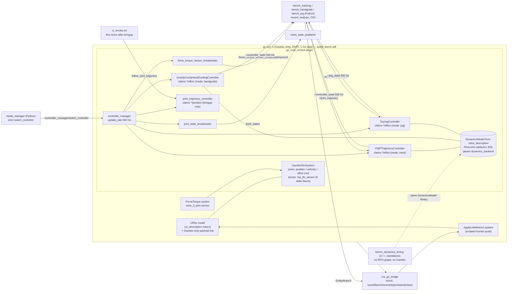

# Architecture

One Gazebo server process hosts the physics, the `gz_ros2_control` hardware plugin and the
`controller_manager` (500 Hz on a 1 ms DART step). Everything that touches the joints in real
time is a C++ ros2_control controller plugin inside that process; Python only orchestrates
(mode switching, benchmark drivers, aggregation and plots).

## Interfaces and who may claim them

| Controller | Command interfaces | State interfaces | Input | Output |
|---|---|---|---|---|
| `joint_trajectory_controller` (stock) | `<joint>/position` | position, velocity | FollowJointTrajectory action, `~/joint_trajectory` | — |
| `pid_ff_trajectory_controller` | `<joint>/effort` | position, velocity | `~/joint_trajectory` (`trajectory_msgs/JointTrajectory`) | `~/controller_state` |
| `gravity_comp_handguide_controller` | `<joint>/effort` | position, velocity | parameters `payload_mass`, `payload_com` (runtime) | `~/controller_state` |
| `tcp_jog_controller` | `<joint>/effort` | position, velocity | `~/twist` (`geometry_msgs/TwistStamped`, root frame, 0.1 s deadman) | `~/controller_state`, `~/jog_state` |
| `force_torque_sensor_broadcaster` (stock) | — | `tcp_fts_sensor/{force,torque}.{x,y,z}` | — | `~/wrench` |

The stock position controller is only used at bringup: once an effort controller has run,
switching a joint back to position drops the arm on gz_ros2_control 3.0.9
([what_broke.md F6](what_broke.md#f6-switching-a-joint-from-effort-back-to-position-drops-the-arm-gz_ros2_control-309)),
so homing uses the effort tracking controller and no mode switches back.

Only one controller may command a joint at a time. `mode_manager` enforces this with a single
STRICT `switch_controller` request that activates the target and deactivates every active
controller claiming any command interface on the same joints (a position and an effort claimant
on one joint would otherwise both be accepted by the resource manager).

## Data flow of one control cycle (2 ms)

1. `gz_ros2_control` reads joint position/velocity and the F/T wrench from Gazebo.
2. The active effort controller reads its state interfaces, evaluates its control law with its
   dynamics backend (allocation-free; buffers are sized in `on_configure`), and writes torques.
3. The controller copies its state into a pre-sized message and hands it to a
   `realtime_tools::RealtimePublisher` (non-blocking `try_publish`).
4. `gz_ros2_control` applies the torques as joint forces for the next two 1 ms physics steps.

Non-realtime work stays out of `update()`: new trajectories are validated and re-profiled in the
subscription callback, and a payload change is built into a new dynamics model in the parameter
callback (for KDL that includes rebuilding its solvers). Both are handed over through a
`RealtimeThreadSafeBox`; the realtime loop only swaps a `shared_ptr` when it can take the box
without blocking, and never frees what it replaces.

## Why the launch file is not a wrapper of `ur_sim_control.launch.py`

On Lyrical the stock launch (ur_simulation_gz 2.5.0) passes no parameter file to its spawners
(ros2_control 6.10.1 then initialises the trajectory controller with no joints) and can spawn the
robot twice when Gazebo boots slowly. `sim.launch.py` keeps the same building blocks and fixes
both; details in its docstring and in
[what_broke.md F7](what_broke.md#f7-the-stock-ur_sim_controllaunchpy-does-not-work-on-lyrical-as-shipped).

## Language split

C++17 for everything in the control loop (controllers, dynamics backends, profiles) and the
timing benchmark; Python for
orchestration, recording, analysis and plots — a 2 ms loop must not depend on a garbage
collector, and nothing outside the loop needs C++.
