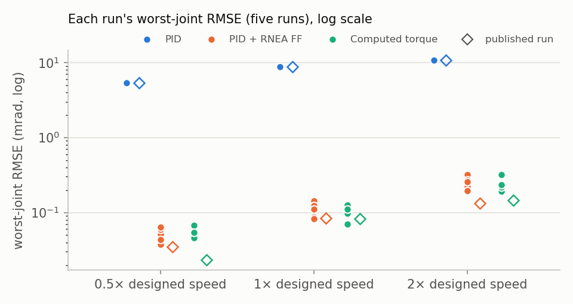

# Results

Every number on this page is computed by `scripts/make_results.py` from the CSVs in `results/`,
which the benchmark scripts write; nothing is typed in by hand. Regenerate everything with
`scripts/regenerate_all.sh`. Simulation only (Gazebo Jetty, DART); see [the
README](../README.md#where-it-fails) for what does not transfer to a real UR5e.

## Summary

| What was measured | Without the model, or with it wrong | With the model | What it means |
|---|---|---|---|
| **Tracking:** RMSE of the worst of the six joints, at the speed the path was designed for (mrad) | PID alone: about 8.8 | PID plus feedforward: 0.08–0.14 computed torque: 0.07–0.13 (lowest–highest of five runs) | About two orders of magnitude less error, with neither law ahead in every run |
| **Hand guiding:** force needed to hold the arm still | model 1 kg, real 0 kg: 9.81 N, pushing down model 1 kg, real 2 kg: 9.81 N, holding up | model 1 kg, real 1 kg: 0.00 N | Equal to Δm·g (the mass error times gravity), by construction. The GIF at the top (model 0 kg, real 1 kg) has the same 1 kg error as the model 1 kg, real 2 kg row |
| **Hand guiding:** how far the tool moves in the first second after letting go | model 1 kg, real 0 kg: rises 296 mm model 1 kg, real 2 kg: sinks 201 mm | model 1 kg, real 1 kg: 0.00 mm | The arm drifts until someone holds it; it moves less when the real payload is 2 kg than when it is 0 kg, because there is more mass to accelerate |
| **Dynamics cost:** time for one RNEA call, median, in µs (microseconds) | — | Pinocchio (the default): 0.78 KDL: 1.50 | Far inside the 2 ms control cycle: 95 % of RNEA calls on either backend finish within 1.7 µs, under a thousandth of the cycle |

Tracking cells are the lowest and highest per-run mean over the five runs in
`results/runs_2026-10-31/` ([run-to-run spread](#run-to-run-spread)); the hand-guiding and timing
cells come from the published single runs below.

## Tracking, full tables

`results/tracking.csv` (the published single run): commit `28074acc45af`, seed 1, physics step 0.001
s, controller update rate 500 Hz, dynamics backend pinocchio; 3 repetitions per condition. Ranges:
`results/runs_2026-10-31/run*_tracking.csv`, five runs ([run-to-run spread](#run-to-run-spread)).

| Speed (× nominal) | Control law | Worst-joint RMSE, published run (mrad, mean ± std over reps) | Worst-joint RMSE over the five runs (mrad, lowest–highest run mean) | Worst max \|e\|, published run (mrad, mean ± std) | Regenerate with |
|---|---|---|---|---|---|
| 0.5 | PID | 5.35 ± 0.01 | 5.34 | 11.90 ± 0.04 | `scripts/bench_tracking.sh` |
| 0.5 | PID + RNEA FF | 0.035 ± 0.005 | 0.038–0.064 | 1.00 ± 0.37 | `scripts/bench_tracking.sh` |
| 0.5 | Computed torque | 0.023 ± 0.002 | 0.046–0.067 | 0.48 ± 0.01 | `scripts/bench_tracking.sh` |
| 1 | PID | 8.83 ± 0.01 | 8.82–8.83 | 20.60 ± 0.05 | `scripts/bench_tracking.sh` |
| 1 | PID + RNEA FF | 0.084 ± 0.003 | 0.083–0.142 | 1.12 ± 0.26 | `scripts/bench_tracking.sh` |
| 1 | Computed torque | 0.082 ± 0.010 | 0.071–0.126 | 1.12 ± 0.25 | `scripts/bench_tracking.sh` |
| 2 | PID | 10.70 ± 0.03 | 10.69–10.70 | 26.08 ± 0.03 | `scripts/bench_tracking.sh` |
| 2 | PID + RNEA FF | 0.133 ± 0.065 | 0.196–0.322 | 2.47 ± 1.05 | `scripts/bench_tracking.sh` |
| 2 | Computed torque | 0.147 ± 0.014 | 0.193–0.318 | 1.98 ± 0.07 | `scripts/bench_tracking.sh` |

Method: the arm is homed by the tracking controller itself (feedforward on) to a seeded random
offset (≤ 0.05 rad per joint) from the home pose; for the PID-only variant feedforward is then
switched off and the integrator given 3 s to carry gravity; the computed-torque variant switches the
same controller to `control_law: computed_torque` (ω, ζ per joint from `controllers.yaml`), with no
integral term. A 3-waypoint path through all 6 joints (2.5 s per segment at 1×, each segment a
rest-to-rest trapezoid) is sent on `~/joint_trajectory`. The error is the controller's own `q_des −
q` at 500 Hz, from trajectory start to 0.5 s after the last reference motion. *Worst joint* is the
joint with the largest RMSE in that repetition; a run's value is the mean over its repetitions.
Tables published before this one (v0.1, and 29 Oct) came from single runs on other days; they are in
[what_broke.md's appendix](what_broke.md#appendix-hand-recorded-runs-not-regenerated-by-any-script)
and should be compared with this page only through the run-to-run spread below.

<picture>
  <source media="(prefers-color-scheme: dark)" srcset="assets/tracking_rmse_dark.png">
  
</picture>

Lower is better. 1× is the speed the path was designed for; 0.5× and 2× run the same path slower or faster. Each bar is the worst joint's RMSE: the median of the five runs, printed above the bar, with a whisker (a thin line from the lowest to the highest run). The left panel is PID alone; the right panel shows PID plus feedforward and computed torque on a scale 30 times finer, because at the left panel's scale they would barely show: every one is below 0.4 mrad, against 5.3–11 mrad for PID. The whiskers on the right are the [run-to-run spread](#run-to-run-spread).

<picture>
  <source media="(prefers-color-scheme: dark)" srcset="assets/tracking_rmse_log_dark.png">
  
</picture>

The same data on a log scale: one dot per run, a hollow diamond for the published run.

Per joint, published run, RMSE / max |e| in mrad, mean ± std over repetitions:

| Speed | Variant | shoulder_pan_joint RMSE / max (mrad) | shoulder_lift_joint RMSE / max (mrad) | elbow_joint RMSE / max (mrad) | wrist_1_joint RMSE / max (mrad) | wrist_2_joint RMSE / max (mrad) | wrist_3_joint RMSE / max (mrad) |
|---|---|---|---|---|---|---|---|
| 0.5 | PID | 0.16 ± 0.01 / 1.06 ± 0.46 | 1.00 ± 0.01 / 2.11 ± 0.08 | 0.08 ± 0.00 / 0.35 ± 0.07 | 1.24 ± 0.12 / 3.07 ± 0.35 | 5.35 ± 0.01 / 11.90 ± 0.04 | 0.04 ± 0.00 / 1.11 ± 0.32 |
| 0.5 | PID + RNEA FF | 0.026 ± 0.004 / 0.76 ± 0.30 | 0.008 ± 0.002 / 0.25 ± 0.10 | 0.011 ± 0.002 / 0.30 ± 0.14 | 0.021 ± 0.002 / 0.56 ± 0.22 | 0.028 ± 0.004 / 0.78 ± 0.32 | 0.035 ± 0.005 / 1.00 ± 0.37 |
| 0.5 | Computed torque | 0.018 ± 0.002 / 0.36 ± 0.01 | 0.006 ± 0.001 / 0.15 ± 0.05 | 0.008 ± 0.001 / 0.19 ± 0.06 | 0.013 ± 0.001 / 0.27 ± 0.00 | 0.021 ± 0.001 / 0.34 ± 0.00 | 0.023 ± 0.002 / 0.48 ± 0.01 |
| 1 | PID | 0.89 ± 0.04 / 3.22 ± 0.11 | 1.92 ± 0.01 / 4.09 ± 0.08 | 0.14 ± 0.00 / 0.52 ± 0.03 | 2.03 ± 0.23 / 4.84 ± 0.61 | 8.83 ± 0.01 / 20.60 ± 0.05 | 0.13 ± 0.02 / 1.26 ± 0.02 |
| 1 | PID + RNEA FF | 0.063 ± 0.003 / 0.83 ± 0.20 | 0.019 ± 0.001 / 0.28 ± 0.07 | 0.025 ± 0.002 / 0.38 ± 0.14 | 0.048 ± 0.002 / 0.60 ± 0.10 | 0.065 ± 0.004 / 0.85 ± 0.19 | 0.084 ± 0.003 / 1.12 ± 0.26 |
| 1 | Computed torque | 0.064 ± 0.007 / 0.85 ± 0.18 | 0.024 ± 0.003 / 0.48 ± 0.23 | 0.031 ± 0.003 / 0.60 ± 0.28 | 0.046 ± 0.006 / 0.66 ± 0.19 | 0.066 ± 0.007 / 0.80 ± 0.20 | 0.082 ± 0.010 / 1.12 ± 0.25 |
| 2 | PID | 4.61 ± 0.20 / 11.75 ± 0.51 | 3.65 ± 0.01 / 7.78 ± 0.18 | 0.41 ± 0.02 / 1.03 ± 0.11 | 2.85 ± 0.32 / 6.43 ± 0.97 | 10.70 ± 0.03 / 26.08 ± 0.03 | 0.52 ± 0.02 / 3.48 ± 0.45 |
| 2 | PID + RNEA FF | 0.117 ± 0.043 / 1.91 ± 0.77 | 0.034 ± 0.010 / 0.44 ± 0.06 | 0.042 ± 0.013 / 0.55 ± 0.07 | 0.075 ± 0.037 / 1.39 ± 0.58 | 0.108 ± 0.048 / 1.91 ± 0.71 | 0.128 ± 0.070 / 2.47 ± 1.05 |
| 2 | Computed torque | 0.128 ± 0.008 / 1.53 ± 0.08 | 0.042 ± 0.007 / 0.46 ± 0.16 | 0.053 ± 0.009 / 0.58 ± 0.19 | 0.080 ± 0.008 / 1.09 ± 0.04 | 0.116 ± 0.010 / 1.38 ± 0.05 | 0.147 ± 0.014 / 1.98 ± 0.07 |

## Run-to-run spread

Five runs of the tracking benchmark on the same code (commit `28074acc45af`, seed 1, 3 repetitions
per condition, every speed and law) were made one after another on 31 Oct 2026, one CSV per run in
`results/runs_2026-10-31/`; `loadavg.csv` there logs the machine's 1-minute load average during each
run. The published single run in the tables above is a separate, earlier run of the same commit.

| Run | Started (UTC+05:30) | 1-min load average: start / mean / end | Heavy-process check at start | Worst-joint RMSE at 1×, PID (mrad) | PID + RNEA FF (mrad) | Computed torque (mrad) | RMSE ÷ RMS(q̇_des) at 1×, PID + RNEA FF (ms, median of the joints) | Computed torque (ms) |
|---|---|---|---|---|---|---|---|---|
| 1 | 18:31 | 1.00 / 2.90 / 5.42 | `none` | 8.82 | 0.142 | 0.126 | 0.299 | 0.267 |
| 2 | 18:39 | 5.42 / 6.94 / 10.26 | `none` | 8.82 | 0.087 | 0.103 | 0.181 | 0.218 |
| 3 | 18:46 | 10.26 / 3.33 / 2.53 | `none` | 8.83 | 0.123 | 0.097 | 0.252 | 0.197 |
| 4 | 18:52 | 2.53 / 2.66 / 2.39 | `none` | 8.82 | 0.110 | 0.110 | 0.225 | 0.232 |
| 5 | 18:59 | 2.39 / 2.04 / 1.48 | `present` | 8.82 | 0.083 | 0.071 | 0.180 | 0.154 |
| published (`results/tracking.csv`) | — | not logged | — | 8.83 | 0.084 | 0.082 | 0.171 | 0.176 |

Across the five runs the PID-only worst-joint RMSE at 1× stays at 8.82–8.83 mrad, while PID + RNEA
FF spans 0.083–0.142 mrad (highest run 1.7 times the lowest) and computed torque 0.071–0.126 mrad
(highest run 1.8 times the lowest). The 1-minute load average does not order the runs: the rank
correlation between a run's mean load and its PID + RNEA FF error is +0.30; the busiest run (run 2,
mean load 6.94) gave 0.087 mrad and the quietest (run 5, mean load 2.04) 0.083 mrad. Run 5: the
heavy-process check at its start reported `present`, and `loadavg.csv` does not record which
process; its mean load, 2.04, was the lowest of the runs.

### RMSE ÷ RMS(q̇_des): a timing offset, not a control error

Divide each joint's RMSE by the RMS of its own reference velocity q̇_des. RMS(q̇_des) is not in the
CSV; it is computed here from the bench's path (`PATH_OFFSETS`, `NOMINAL_SEGMENT_S` and `SETTLE_S`
in `bench_tracking.py`) and the 1/3-rule trapezoid of `profiles/trapezoidal.hpp`, over the same
window as the RMSE (every row's profiled duration matches the requested one, so no segment was
stretched by a limit). If the residual came from the control law, this ratio would differ from joint
to joint: the six joints differ by orders of magnitude in inertia, and their Kp by a factor of 2400.
It does not. For PID + RNEA FF and computed torque at 1×, the largest of the joints' ratios is at
most 1.43 times the smallest, in every run (at most 1.76 at any speed), while for PID alone it is 60
to 93 times. An error proportional to each joint's own reference speed, with one constant shared by
every joint, is what a fixed offset in time between q_des and q produces: if the recorded q lags its
reference by δ, then e ≈ q̇_des·δ, so the ratio is δ. At 1× it is 0.17 ms in the published run and
0.18–0.30 ms across the five runs (PID + RNEA FF, median over the joints), shorter than one 1 ms
physics step, and different in every run. That offset, not the control law and not CPU load, sets
the feedforward and computed-torque rows. Where it comes from (sampling, stamping, or which physics
step the reference is evaluated at) is not measured yet; see
[what_broke.md](what_broke.md#timing-offset-between-reference-and-state). PID alone gives
wrist_3_joint (the joint with the smallest Kp) a ratio of 0.27 ms in the published run, close to the
model-based laws': its PID-only error is mostly this offset too, so its PID-only RMSE at 1× moves
between runs (0.13–0.19 mrad over the five runs) while the worst-joint PID number, set by
wrist_2_joint, does not. Ratios and tables recorded on other days (29 Oct, v0.1) are not regenerated
by any script and are in [what_broke.md's
appendix](what_broke.md#appendix-hand-recorded-runs-not-regenerated-by-any-script).

| At 1× nominal speed | shoulder_pan_joint | shoulder_lift_joint | elbow_joint | wrist_1_joint | wrist_2_joint | wrist_3_joint | Largest ÷ smallest |
|---|---|---|---|---|---|---|---|
| Kp (N·m/rad, `controllers.yaml`) | 600 | 1200 | 500 | 30 | 8 | 0.5 | 2400 |
| RMS(q̇_des) (rad/s, from the profile) | 0.367 | 0.122 | 0.154 | 0.276 | 0.367 | 0.490 | 4.00 |
| PID, published run (ms) | 2.41 | 15.7 | 0.938 | 7.33 | 24.0 | 0.267 | 90 |
| PID + RNEA FF, published run (ms) | 0.171 | 0.157 | 0.160 | 0.172 | 0.176 | 0.171 | 1.12 |
| Computed torque, published run (ms) | 0.173 | 0.198 | 0.198 | 0.167 | 0.179 | 0.168 | 1.18 |
| PID + RNEA FF, five runs, lowest–highest (ms) | 0.175–0.291 | 0.166–0.355 | 0.165–0.354 | 0.178–0.296 | 0.181–0.301 | 0.169–0.290 | 1.11–1.43 (per run) |
| Computed torque, five runs, lowest–highest (ms) | 0.152–0.264 | 0.170–0.301 | 0.168–0.298 | 0.145–0.261 | 0.157–0.269 | 0.144–0.258 | 1.06–1.32 (per run) |

## Hand guiding

`results/handguide.csv`: commit `28074acc45af`, seed 1, physics step 0.001 s, controller update rate 500 Hz, dynamics backend pinocchio; 3 repetitions per condition.

| Model / actual payload (kg) | Payload error (kg) | TCP drift speed at 1 s (mm/s) | TCP drift in 1 s (mm) | Effort to hold, F_z (N) | Expected (Δm·g, N) | Regenerate with |
|---|---|---|---|---|---|---|
| 1 / 0 | -1 | 374.41 ± 1.96 | 296.18 ± 4.44 | -9.81 ± 0.00 | -9.81 | `scripts/bench_handguide.sh` |
| 1 / 1 | +0 | 0.00 ± 0.00 | 0.00 ± 0.00 | 0.00 ± 0.00 | 0.00 | `scripts/bench_handguide.sh` |
| 1 / 2 | +1 | 202.04 ± 2.48 | 200.91 ± 3.35 | 9.81 ± 0.00 | 9.81 | `scripts/bench_handguide.sh` |

Method: per repetition the tracking controller holds the arm at a seeded random offset (≤ 0.05 rad
per joint) from home until its integrator has converged (3 s); its torque is then what the simulated
arm needs to stay put. The hand-guiding controller then takes over with the model payload and nobody
touches the arm. *Effort to hold* is the tool force an operator must apply to keep the arm still, F
= J(q)⁻ᵀ (τ_hold − τ_handguide) at the release pose; its z component should equal (m_actual −
m_model)·g. *Drift* is the TCP linear speed |J(q) q̇| over [0.9, 1.0] s after release and the TCP
displacement at 1 s.

The measured F_z differs from Δm·g by at most 0.0001 N over all 9 rows, the last digit the CSV
records. That agreement holds by construction, so it is a placement check, not a measurement: Gazebo
(DART) and Pinocchio are given the same URDF and the same gravity (9.81 m/s², the `gravity_z`
parameter, set explicitly in the worlds), so the benchmark confirms that the payload model enters
the dynamics at the right place and that a hand-over between controllers is seamless. On a real arm
this is exactly where friction and model error would appear. Earlier versions of this benchmark
showed an offset in the hold force; the two causes (SDF's default gravity of 9.8 m/s², and a
controller that zeroed its torque on deactivation) are described in [what_broke.md](what_broke.md),
and the hand-recorded offsets are in [its
appendix](what_broke.md#appendix-hand-recorded-runs-not-regenerated-by-any-script).

<picture>
  <source media="(prefers-color-scheme: dark)" srcset="assets/handguide_dark.png">
  
</picture>

The three measured points sit on the Δm·g line (mass error times gravity, 9.81 N per kg) to within 0.0001 N. Positive means the operator has to push up, because the model is too light and the arm would sink; negative means push down. They sit on the line by construction, because the simulator and the controller use the same model and the same gravity; a controller that put the payload in the wrong place would miss it. On a real arm, friction and model error would move the points off the line.

## Dynamics timing

`results/dynamics_timing.csv`: commit `28074acc45af`, build type RelWithDebInfo, CPU 11th Gen Intel(R) Core(TM) i5-1135G7 @ 2.40GHz, 100,000 timed calls per row, seed 1.

| Per call, median / p95 (µs) | Pinocchio g(q) | Pinocchio RNEA | KDL g(q) | KDL RNEA | Worst p95, share of the 2 ms cycle | Regenerate with |
|---|---|---|---|---|---|---|
| UR5e, 6 DoF, one thread | 0.484 / 0.537 | 0.784 / 0.855 | 1.450 / 1.540 | 1.495 / 1.619 | 0.0809 % | `scripts/bench_dynamics_timing.sh` |

| Backend | Call | Median (µs) | p95 (µs) | Mean (µs) | Max (µs) | Median, share of 2 ms | p95, share of 2 ms |
|---|---|---|---|---|---|---|---|
| Pinocchio | g(q) | 0.484 | 0.537 | 0.494 | 17.95 | 0.0242 % | 0.0269 % |
| Pinocchio | RNEA | 0.784 | 0.855 | 0.797 | 118.85 | 0.0392 % | 0.0427 % |
| KDL | g(q) | 1.450 | 1.540 | 1.466 | 117.10 | 0.0725 % | 0.0770 % |
| KDL | RNEA | 1.495 | 1.619 | 1.517 | 23.10 | 0.0748 % | 0.0809 % |
| — | two clock reads only | 0.038 | 0.048 | 0.038 | 6.46 | 0.0019 % | 0.0024 % |

Method: `bench_dynamics_timing` (C++, no ROS graph, no simulator, one thread) loads the simulation's
URDF into each backend through the same `DynamicsModel` interface the controllers use, draws the
states up front (q uniform inside the URDF position limits, q̇ inside the velocity limits, |q̈| ≤ 10
rad/s², seeded), makes 1 000 warm-up calls and then times every call on its own with
`std::chrono::steady_clock`. Times include the wrapper's joint reordering and the timer itself (the
*two clock reads only* row); nothing is subtracted. *Share of 2 ms* is the time divided by one
control cycle. `scripts/bench_dynamics_timing.sh` refuses to run next to a simulator, build, pip
install or training run, and its log records the load average and the busiest processes at start; on
the shared dev laptop it runs under the machine's heavy, build and Gazebo locks. Medians move from
run to run; reruns recorded by hand on 29 Oct are in [what_broke.md's
appendix](what_broke.md#appendix-hand-recorded-runs-not-regenerated-by-any-script). These are laptop
numbers: CI runs the executable as a 1 000-call smoke test only, and runner timings are not
published.
